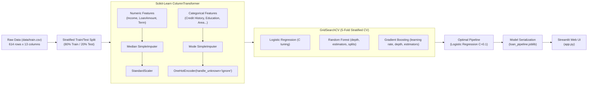

# 🏦 Loan Approval Predictor: End-to-End Pure Machine Learning Pipeline

[](https://www.python.org/)
[](https://scikit-learn.org/)
[](https://streamlit.io/)
[](LICENSE)

An end-to-end, classical machine learning project to automate credit risk assessment and predict loan eligibility. Built on real data from the [Kaggle / Analytics Vidhya Loan Prediction Dataset](https://www.kaggle.com/datasets/altruistdelhire04/loan-prediction-problem-dataset).

---

## 📌 Project Overview

Manual loan approval workflows can be slow, inconsistent, and error-prone. This project implements a **leak-free Scikit-Learn `Pipeline`** with hyperparameter tuning via **`GridSearchCV`** that consumes raw applicant demographics and financial attributes, performs automated data imputation and encoding, and predicts whether a loan should be approved or rejected with confidence scoring.

### Key Highlights
* **Single Master Notebook** ([`loan_prediction.ipynb`](loan_prediction.ipynb)): Covers the complete workflow from raw data EDA to serialized pipeline export.
* **Hyperparameter Optimization**: Systematic parameter tuning using `GridSearchCV` with **5-Fold Stratified Cross-Validation**.
* **Leakage-Free Architecture**: All transformations (imputation, scaling, one-hot encoding) are encapsulated within a `ColumnTransformer` and fit strictly on training splits.
* **Interactive Web Deployment** ([`app.py`](app.py)): A modern Streamlit dashboard with presets, live debt ratios, approval confidence meters, and explainable risk factors.

---

## 🏗️ Architecture & Pipeline Flow



---

## 📊 Dataset Features & Missing Value Strategy

The dataset contains 614 applicant records with 12 input features and 1 target variable (`Loan_Status`):

| Feature | Type | Missing Values | Strategy | Description |
|:---|:---|:---:|:---|:---|
| `Loan_ID` | Identifier | 0 | Dropped | Unique Applicant ID |
| `Gender` | Categorical | 13 | Mode Imputation + OneHot | Male / Female |
| `Married` | Categorical | 3 | Mode Imputation + OneHot | Marital status (Yes / No) |
| `Dependents` | Categorical | 15 | Mode Imputation + OneHot | Number of dependents (0, 1, 2, 3+) |
| `Education` | Categorical | 0 | OneHot | Applicant education (Graduate / Not Graduate) |
| `Self_Employed` | Categorical | 32 | Mode Imputation + OneHot | Self-employed (Yes / No) |
| `ApplicantIncome` | Numeric | 0 | StandardScaler | Monthly income in USD |
| `CoapplicantIncome`| Numeric | 0 | StandardScaler | Monthly co-applicant income in USD |
| `LoanAmount` | Numeric | 22 | Median Imputation + StandardScaler | Requested loan amount in thousands |
| `Loan_Amount_Term` | Numeric | 14 | Median Imputation + StandardScaler | Loan duration in months (e.g. 360 = 30 yrs) |
| `Credit_History` | Categorical | 50 | Mode Imputation + OneHot | Meets credit guidelines (1.0 = Yes, 0.0 = No) |
| `Property_Area` | Categorical | 0 | OneHot | Urban / Semiurban / Rural |
| **`Loan_Status`** | **Target** | 0 | Mapped to 1 (Y) / 0 (N) | **Approved (Y: 422) vs Rejected (N: 192)** |

---

## 📓 Notebook Walkthrough (`loan_prediction.ipynb`)

The notebook is divided into 7 self-contained, documented sections:

1. **Data Ingestion & Inspection**: Loads `data/train.csv`, displays statistical summaries, and profiles missing value percentages.
2. **Exploratory Data Analysis (EDA)**:
   * Analyzes target imbalance (~68.7% Approved vs. 31.3% Rejected).
   * Visualizes the critical role of `Credit_History` in loan approval rates.
   * Demographic distributions across Education, Marital status, Property Area, and Dependents.
   * Right-skewed distribution analysis for `ApplicantIncome` and `LoanAmount`.
3. **Data Preprocessing**: Sets up the Scikit-Learn `ColumnTransformer` with `SimpleImputer`, `StandardScaler`, and `OneHotEncoder(handle_unknown='ignore')`.
4. **Train/Test Split & Hyperparameter Tuning with `GridSearchCV`**:
   * Evaluates hyperparameter combinations over a Stratified 5-Fold split.
   * **Logistic Regression**: Regularization parameter `C ∈ [0.01, 0.05, 0.1, 0.5, 1.0, 10.0]`.
   * **Gradient Boosting**: `learning_rate ∈ [0.01, 0.05, 0.1]`, `max_depth ∈ [2, 3, 4]`, `n_estimators ∈ [50, 100, 150]`.
   * **Random Forest**: `n_estimators ∈ [50, 100, 200]`, `max_depth ∈ [3, 5, 8, None]`, `min_samples_split ∈ [2, 5]`.
5. **Model Evaluation & Comparison**: Compares the tuned models across CV accuracy, test accuracy, precision, recall, F1, and ROC-AUC. Plots confusion matrices and ROC curves.
6. **Feature Importance**: Analyzes the top positive and negative regression coefficients to explain model decisions.
7. **Model Serialization**: Saves the final end-to-end pipeline into `loan_pipeline.joblib` and validates inference with a test applicant profile.

---

## 📈 Model Performance & Benchmark Results

All models were tuned on the training set (491 samples) using **5-Fold Stratified Cross-Validation** and evaluated on the holdout test set (123 samples):

| Model | Optimal Hyperparameters | 5-Fold CV Accuracy | Test Accuracy | Precision | Recall | F1-Score | ROC-AUC |
|:---|:---|:---:|:---:|:---:|:---:|:---:|:---:|
| **Logistic Regression (Selected)** | `{'C': 0.1}` | **80.03%** | **86.18%** | **0.8400** | **0.9882** | **0.9081** | **0.8508** |
| Random Forest | `{'max_depth': 5, 'min_samples_split': 2, 'n_estimators': 50}` | 80.03% | 85.37% | 0.8317 | 0.9882 | 0.9032 | 0.8098 |
| Gradient Boosting | `{'learning_rate': 0.01, 'max_depth': 2, 'n_estimators': 100}` | 79.62% | 84.55% | 0.8235 | 0.9882 | 0.8984 | 0.8067 |

### Key Business Insights
1. **Credit History Dominance**: `Credit_History = 1.0` holds the largest positive coefficient (+1.25), while `Credit_History = 0.0` is the strongest rejection predictor (-1.24).
2. **Geographic Advantage**: Properties in **Semiurban** areas correlate with a higher approval rate (+0.36) compared to Rural areas (-0.25).
3. **High Approval Recall**: The selected model achieves **98.8% recall** on approved loans, minimizing false rejections for qualified applicants.

---

## 🌐 Streamlit Web Application (`app.py`)

The application serves the serialized model through an intuitive user interface:
* **Applicant Form**: Personal, financial, and credit history inputs.
* **Live Financial KPIs**: Real-time computation of **Total Monthly Income**, **Requested Loan Amount**, and **Loan Term**.
* **Quick Presets**: 1-click loading of:
  * 🎯 *Ideal Candidate (Low Risk)*: High income, positive credit history $\rightarrow$ **Approved (>85% confidence)**.
  * ⚠️ *High Risk Candidate*: History of defaults, high debt burden $\rightarrow$ **Rejected (<15% confidence)**.
* **Decision Card & Gauge**: Instant approval badge with an animated probability bar and explanatory factor bullet points.
* **Self-Healing Fallback**: If the model artifact is missing, `app.py` automatically retrains and saves a new pipeline from `data/train.csv`.

---

## 🚀 Quickstart & Reproduction

### 1. Clone & Install Dependencies
```bash
git clone https://github.com/your-username/loan-approval-predictor.git
cd loan-approval-predictor

# Optional: Create and activate virtual environment
python -m venv venv
# On Windows: venv\Scripts\activate
# On Linux/macOS: source venv/bin/activate

pip install -r requirements.txt
```

### 2. Run the Master Jupyter Notebook
```bash
jupyter notebook loan_prediction.ipynb
```

### 3. Launch the Streamlit App
```bash
streamlit run app.py
```
Open `http://localhost:8501` in your browser.

---

## 📂 Project Structure

```text
loan-approval-predictor/
├── data/
│   └── train.csv               # Official Kaggle Loan Prediction dataset (614 rows)
├── loan_prediction.ipynb       # Single master notebook: EDA, GridSearch, eval & export
├── app.py                      # Interactive Streamlit web application
├── loan_pipeline.joblib        # Pre-trained Scikit-Learn Pipeline artifact
├── requirements.txt            # Python dependencies (pandas, scikit-learn, etc.)
├── README.md                   # Comprehensive project documentation
├── .gitignore                  # Git ignore rules for virtualenvs, caches, checkpoints
└── LICENSE                     # MIT License
```

---

## 📄 License
This project is open-source and available under the [MIT License](LICENSE).
